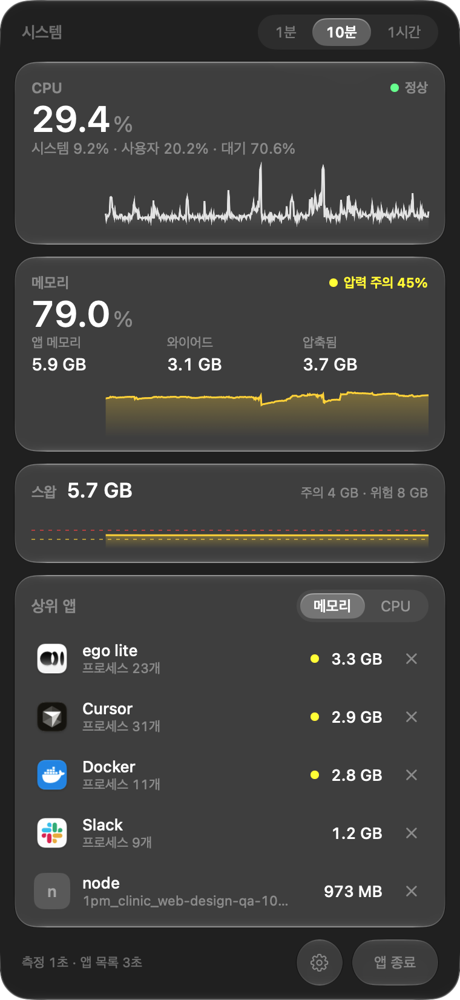

<div align="center">

# mac-monitor

**맥이 멈추기 전에 알아채고, 원인 앱을 바로 끄는 메뉴바 앱**

스왑과 메모리 압박을 지켜보다가 위험해지면 알려 주고, 메모리를 가장 많이 쓰는 앱을 한 번에 종료합니다.<br>
헬퍼 프로세스 100개 이상으로 쪼개진 앱도 앱 단위로 합산해서 보여줍니다.


<sub>메뉴바에는 숫자 없이 앵무새만 있습니다. CPU를 많이 쓸수록 빨리 춤춥니다.</sub>

</div>

<p align="center">
  
</p>

## 주요 기능

| 기능 | 내용 |
| --- | --- |
| [메뉴바 앵무새](#메뉴바-앵무새) | 전체 CPU 사용률에 따라 춤추는 속도가 바뀌는 10프레임 아이콘 |
| [시스템 그래프](#시스템-그래프) | CPU·메모리·스왑 수치와 1분 / 10분 / 1시간 그래프 |
| [상위 앱](#상위-앱) | 메모리·CPU 상위 앱, 앱 단위 합산, 펼쳐서 하위 프로세스 보기 |
| [앱 종료](#앱-종료) | × 한 번으로 종료, 응답이 없으면 강제종료 확인 |
| [알림](#알림) | 메모리 위험·CPU 급증 알림, 알림 버튼으로 원인 앱 종료 |
| [설정](#설정) | 위험 기준, 다시 알림 간격, 로그인 시 실행 |

### 메뉴바 앵무새

메뉴바에 숫자 대신 파티 앵무새가 있습니다. 맥이 한가하면 느긋하게, CPU를 많이 쓰면 정신없이 춤춥니다. 앵무새를 누르면 팝오버가 열립니다. 팝오버는 제어 센터처럼 투명한 Liquid Glass로 그리고, 평소엔 무채색이다가 주의·위험일 때만 색이 나타납니다.

### 시스템 그래프

- **CPU**: 전체 사용률과 시스템·사용자·대기 비율. 앱 하나라도 300%를 넘으면 상태가 `주의`로 바뀝니다.
- **메모리**: 앱 메모리·와이어드·압축됨, 그리고 `압력 정상 41%` 같은 메모리 압력 표시. 계산 방식은 활성 상태 보기와 같습니다.
- **스왑**: 사용량과 함께 주의(4 GB)·위험(8 GB) 기준선을 점선으로 그립니다.
- 그래프 범위는 **1분 / 10분 / 1시간**입니다. 측정값은 메모리에만 1시간 보관하고 디스크에 저장하지 않습니다.
- 메모리가 위험해지면 맨 위에 `메모리 위험 — 스왑 12.7 GB` 배너가 뜨고, 몇 분째인지와 가장 큰 원인 앱을 알려 줍니다.

### 상위 앱

- 메모리 또는 CPU 기준 상위 앱을 보여줍니다. 메모리는 RSS가 아니라 `phys_footprint`로 셉니다. RSS는 실제보다 훨씬 작게 나오기 때문입니다.
- **GUI 앱은 .app 번들 단위로 합산**합니다. 헬퍼 96개로 나뉜 앱도 한 줄로 보입니다.
- **터미널에서 띄운 CLI 프로세스**(node, next-server, vite, python 등)는 터미널 앱에 묶지 않고 `명령 이름 · 작업 폴더 · :포트`로 따로 보여줍니다. 같은 폴더에서 띄운 같은 명령은 한 줄로 합칩니다.
- 행을 누르면 하위 프로세스가 펼쳐집니다. 같은 실행 파일끼리 묶어 메모리 상위 3줄과 `그 외 N개`를 보여줍니다.
- 상태 점: 메모리 위험이면 1위 원인 앱이 빨강, 2·3위가 노랑입니다. CPU 300% 이상인 앱도 노랑입니다. 정상인 앱에는 점이 없습니다.

### 앱 종료

- ×를 누르면 그 앱의 프로세스 전체에 즉시 `SIGTERM`을 보냅니다.
- 3초 뒤에도 살아 있으면 그 행 아래에 **강제종료 확인**이 뜨고, 사용자가 누를 때만 `SIGKILL`을 보냅니다.
- 내 계정의 프로세스만 종료할 수 있습니다. 시스템 프로세스와 이 앱 자신에는 ×가 없고, root 권한을 요청하지 않으며, 자동으로 종료하지 않습니다.

### 알림

| 알림 | 조건 | 소리 |
| --- | --- | --- |
| `[위험] 메모리 — 스왑 12.7 GB` | 스왑 8 GB 초과 또는 사용 가능 메모리 20% 미만 | 기본 알림음 |
| `[주의] CPU 급증 — next-server 340%` | 앱 하나가 CPU 300% 이상을 30초 넘게 유지 | 무음 |

- 메모리 알림에는 원인 상위 앱 3개가 나오고, 알림 버튼으로 바로 종료할 수 있습니다. 알림을 누르면 팝오버가 열립니다.
- 위험이 계속되면 설정한 간격(기본 10분)마다 다시 알리고, 정상으로 돌아오면 초기화합니다.

### 설정

팝오버 아래 톱니 버튼으로 엽니다. 값은 UserDefaults에 저장됩니다.

| 항목 | 기본값 |
| --- | --- |
| 로그인 시 자동 실행 | 켬 |
| 스왑 주의 / 위험 | 4 GB / 8 GB |
| 사용 가능 메모리 위험 | 20% 미만 |
| 앱 하나의 CPU 주의 | 300% (코어 1개 = 100%) |
| CPU 급증 지속 시간 | 30초 |
| 위험이 계속되면 다시 알림 | 10분마다 (5분 / 30분 / 다시 안 함) |

## 요구 사항

- macOS 27 이상
- Xcode 27.1 (Swift 6)

개인용 앱이라 App Store 배포나 공증(notarization)이 없습니다. 다른 프로세스를 읽고 종료해야 해서 샌드박스를 쓰지 않습니다.

## 빌드와 설치

```bash
git clone https://github.com/tunggary/mac-monitor.git
cd mac-monitor
xcodebuild -project MacMonitor.xcodeproj -scheme MacMonitor -configuration Release -derivedDataPath build build
cp -R build/Build/Products/Release/mac-monitor.app /Applications/
open /Applications/mac-monitor.app
```

Xcode에서 `MacMonitor.xcodeproj`를 열어 실행해도 됩니다. 서명은 "Sign to Run Locally"라 Apple 개발자 계정이 없어도 빌드됩니다. 처음 실행하면 알림 권한을 묻습니다.

## 기술 스택

| 영역 | 기술 |
| --- | --- |
| 언어·UI | Swift 6 (strict concurrency) · SwiftUI · AppKit · Swift Charts |
| 시스템 측정 | `host_statistics64` · `sysctl` (`vm.swapusage`, `kern.memorystatus_level`) |
| 프로세스 측정 | `proc_listallpids` · `proc_pidinfo` · `proc_pid_rusage` · `proc_pidfdinfo` |
| 알림·자동 실행 | UserNotifications · `SMAppService` |
| 테스트 | Swift Testing |

외부 라이브러리는 쓰지 않습니다. 시스템 지표는 1초, 프로세스 목록은 3초마다 측정하고, 앱 자체는 CPU 1% 미만·메모리 80 MB 미만을 목표로 합니다.

## 개발

```bash
xcodebuild -project MacMonitor.xcodeproj -scheme MacMonitor -derivedDataPath build test
```

| 경로 | 역할 |
| --- | --- |
| `MacMonitor/App` | 앱 시작, 측정·판정·알림을 잇는 `AppModel` |
| `MacMonitor/Measurement` | 시스템·프로세스 측정, 앱 묶기, 1시간 링버퍼 |
| `MacMonitor/Status` | 주의·위험 판정, 행 문구, 그래프 데이터, 설정값 |
| `MacMonitor/MenuBar` | 메뉴바 아이콘과 앵무새 애니메이션 |
| `MacMonitor/Popover` | 팝오버 화면 |
| `MacMonitor/Kill` | 종료·강제종료 |
| `MacMonitor/Alerts` | 알림 조건과 알림 보내기 |
| `MacMonitor/Settings` | 설정 창, 로그인 시 실행 |
| `MacMonitor/Theme` | 유리·색 토큰 (Liquid Glass, 시스템 색) |
| `design/` | 화면 시안 HTML, 앵무새 원본 프레임 |
| `scripts/make-app-icon.swift` | 번개 앱 아이콘 생성 |

결정 사항과 수치는 [구현 스펙](docs/SPEC.md) 하나에 모읍니다. 결정이 바뀌면 스펙도 같이 고칩니다.

- 브랜치는 Git Flow를 따릅니다: `develop`에서 `feature/*`를 따서 다시 `develop`으로, 릴리스는 `release/x.y.z`를 거쳐 `main`과 `develop`에 머지합니다.
- 커밋 메시지는 `<type>: <제목>`이고 type은 `feat` `add` `fix` `build` `style` `refactor` `docs` `test` `etc` 중 하나입니다.
- 버전은 Semantic Versioning이고 Xcode `MARKETING_VERSION`에 둡니다. 릴리스 절차는 [스펙](docs/SPEC.md)의 "버전 관리" 절을 참고하세요.

## 알려진 한계

- 앵무새가 흰색 고정이라 밝은 메뉴바에서는 잘 안 보일 수 있습니다.
- WindowServer, kernel_task 같은 다른 계정 프로세스는 root 없이 메모리·CPU를 읽을 수 없어 상위 앱 목록에 나오지 않습니다. 전체 CPU·메모리·스왑 수치는 시스템 전체 값이라 영향이 없습니다.
- 캐릭터는 지금 파티 앵무새 하나뿐입니다. 교체할 수 있는 구조만 있습니다.
